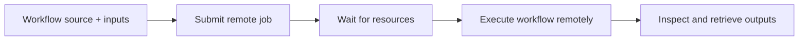

# Jobs

The [Workflows](workflows.md) example describes a procedure: create the number
`4`, calculate its double and triple, then write a report. Running it locally
uses `fm.execute(...)`. Now suppose you want a remote machine to perform that
same work.

A **job** is one submitted request to execute the workflow through a platform.
It has a remote identifier, requested resources, a lifecycle, and output files.
It is not another definition of the tasks, and submission does not mean the
calculation has started or succeeded.



We will keep the example's tasks and stages unchanged. Only the way we start
the procedure changes. The files are now created in a remote workspace rather
than on our computer; later, we will retrieve the report from that workspace.

## 1. Submit The Same Example

Keep the callbacks and `build_workflow()` in the same Python file. Instead of
asking `fm.execute()` to start them here, ask `fm.submit()` to send the procedure
to a configured execution platform. This can be an HPC system or a cloud
environment with suitable adapters; the workflow itself does not choose the
provider's authentication, resource-request, or launcher rules.

The submission supplies the same `inputs={"base_value": 4}` as before.
`function=build_workflow` identifies the factory to reconstruct remotely;
it does not call the factory or build the model locally. The provider choice
and requested resources belong in submission settings, not in those inputs.

??? example "Concrete submission setup: TACC"
    This is one implemented adapter, not a definition of how every provider
    must work. Other cloud/HPC routes require appropriate adapters; they are
    not enabled merely by changing a provider name. Replace the local execution
    block with the following example when using this deployment:

    ```python
    if __name__ == "__main__":
        job = fm.submit(
            function=build_workflow,
            platform="tacc",
            settings={
                "app_id": "YOUR_REGISTERED_FEMORA_APP_ID",
                "system": "YOUR_EXECUTION_SYSTEM",
                "queue": "YOUR_LOGICAL_QUEUE",
                "allocation": "YOUR_ALLOCATION",
                "nodes": 1,
                "cores_per_node": 1,
                "minutes": 10,
            },
            inputs={"base_value": 4},
        )
        print(f"Job UUID: {job.id}")
    ```

    This authenticates, uploads files, and submits real work. Replace all
    placeholders and resource counts using your deployment's accepted values;
    its minimum resource request may exceed this tiny calculation's needs.
    The source still contains the earlier `import femora as fm`, callbacks,
    and factory. For noninteractive configuration, use an authenticated
    [platform object](../reference/jobs/platforms/TACCPlatform/index.md).

The returned `job` is a handle for this submission, not the completed report
or a local `RunResult`. Its `id` lets us find this particular request later.
Keep submission behind the main guard so importing the workflow source
remotely cannot submit another job. Keep the callbacks and factory outside it.

See [submit()](../reference/jobs/submit/index.md) for source-file and existing
bundle alternatives, and for the complete settings/submission contract.

## 2. Follow The Example To The Remote Machine

The source is packaged without calling `build_workflow()` locally:

1. Your computer creates a **bundle** containing the workflow source, saved
   inputs, and explicitly declared data files.
2. The platform authenticates, checks resources, uploads that bundle, and
   submits a job through the provider.
3. The job waits for resources. Once started, the remote application prepares
   its execution environment and **replays** the bundle.
4. Replay imports your source, calls `build_workflow()`, and runs its stages.
   `prepare/write_base_value` writes `4`; `calculate/double` and
   `calculate/triple` produce `8.0` and `12.0`; `report/write_summary` combines them.
5. The application makes its output package available for retrieval.

A bundle is a transport format, not a complete software environment. Replay
executes its Python source; only use trusted bundles. Checksums detect file
inconsistencies, not whether the workflow is safe or its author is trustworthy.

???+ note "Python packages and solver builds are not uploaded automatically"
    The remote environment must supply Femora, packages used by your callbacks,
    and any solver or MPI software the tasks need. Imported helper modules are
    not automatically collected from your project. Declare required files
    explicitly and verify that external shared input paths are accessible there.

Use [bundle()/replay()](../reference/jobs/bundle/index.md) when you want to
package or replay explicitly. Ordinary `submit(function=...)` handles packaging
for you; it does not install missing dependencies.

## 3. Decide What Resources This Run Needs

The calculation example's tasks run sequentially and reserve one core each.
For a solver using one CPU per MPI process, a parallel stage with tasks
requesting 8 and 16 ranks needs 24 simultaneous cores. A sequential stage
containing the same tasks needs a maximum of 16 at a time. Resources are
reused between stages, not added across the entire workflow.

Suppose an execution has 48 allocated cores and uses one core per MPI rank.
Two independent solver tasks with 8 and 16 ranks use 24 of them while running
together. They do not each receive all 48 cores. Increasing the second task
to 48 ranks makes their combined demand 56, so that parallel stage no longer
fits. Sequential execution would instead require at most 48 at once.

The **platform** requests these resources from the provider. Once they exist,
an **execution backend** launches the individual tasks on them. Requesting
48 cores does not itself start 48 MPI ranks or parallelize a Python callback.
Task definitions describe that work; the backend maps it to the available
launcher. None of this arithmetic depends on calling the machine TACC or
on whether it is hosted on premises or in a cloud.

Your resource request must fit the workflow and the provider's queue rules.
It does not repartition a mesh or configure a program's internal threads.
Check the provider's resource metadata rather than assuming all machines
share node sizes or wall-time limits. For the concrete TACC adapter, see
[resource validation](../reference/jobs/platforms/TACCValidator/index.md) and
the [allocation backend requirements](../reference/jobs/TACC/index.md).

The [cores and ranks example](workflows.md#9-understand-cores-ranks-and-parallel-stages)
shows what changes when the budget is 48 versus 32 cores, or one task's rank
count increases. The same arithmetic applies regardless of the provider,
subject to its actual CPU/rank mapping.

Preflight reports known errors, warnings, and unverified conditions. A valid
report means no known blocking errors; it is not a guarantee of execution.
For bundled source not imported locally, actual task capacity is checked when
the remote runner constructs the workflow. Memory, allocation balance,
installed packages, permissions, and input readability can remain unverified.

???+ warning "An uncertain submission outcome is not a safe retry"
    A connection can fail after the provider accepted the request. Inspect
    remote jobs before retrying an uncertain submission, or you can create
    duplicate work. A successful submission handle also does not mean the
    solver converged or produced valid numerical results.

## 4. Find The Run's Workspace

The application creates a workspace for this execution inside its remote
job directory. Its actual location is reported by the provider/application;
it is not your source directory or automatically the same path used locally.
Our example produces the same stage/task structure there:

```text
remote workspace/
    prepare/write_base_value/base_value.txt
    calculate/double/value.txt
    calculate/triple/value.txt
    report/write_summary/summary.txt
    manifest.json
```

The task folders come from the workflow names. The files inside them come
from the callbacks; `manifest.json` comes from the runner. Remote application
and scheduler logs may live outside this workspace, in locations supplied
by the execution platform. There is no universal cloud or cluster log path.

The calculation uses Python callbacks, so it does not automatically create
a separate `stdout.log` per task. An external command or solver task creates
that log when it reaches program launch; recorder output still goes where
the model configured it. See the
[workspace walkthrough](workflows.md#8-inspect-the-workspace-and-diagnose-a-failure)
for the full file and manifest responsibilities.

## 5. Send An Existing Input File

The small example creates its input during execution, so it needs no uploaded
data file. For a workflow that reads an existing local file, add a `files`
mapping to the submission call:

```python
from pathlib import Path

files = {"motions/input.acc": Path(__file__).with_name("input.acc")}
```

Pass `files=files` alongside `inputs` and `settings`. This mapping is
**workspace-relative destination: existing local source**:

| Expression | Meaning |
| --- | --- |
| `"motions/input.acc"` | Where the file appears relative to the remote workspace |
| `Path(__file__).with_name("input.acc")` | The local file beside your workflow source |

<section class="workspace-view" aria-label="Workspace after staging an uploaded input">
  <header class="workspace-heading"><span class="workspace-kicker">Before the first task</span><strong>Declared input in the shared workspace</strong></header>
  <div class="workspace-body">
    <div class="workspace-tree"><code>workspace/</code><ul><li class="workspace-new"><code>motions/</code><ul><li class="workspace-new"><code>input.acc</code><span class="workspace-tag">uploaded</span></li></ul></li></ul></div>
    <div class="workspace-context"><strong>The callback reads</strong><p><code>context.workspace / "motions/input.acc"</code></p><p>This is an uploaded input path, not a task folder or the original local path.</p></div>
  </div>
</section>

Never put credentials or tokens into settings, source files, inputs, or bundles.
Authentication belongs to the platform's connection, not to your task data.

## 6. Track The Job Without Resubmitting

The submission block returned `job`. Ask that same handle what happened:

```python
status = job.status()
print(job.id, status.state, status.native_state)
```

`status.state` is Femora's normalized state; `native_state` preserves the
provider's wording. A pending job may still be waiting for resources, so the
calculation's task folders need not exist yet. Running means the remote job is
active, not that our report has already been written. A terminal state tells
us this attempt ended, with success, failure, or cancellation.

Querying status does not submit again. Save the printed ID: it identifies
this execution request even after the submitting Python process exits.

To reconnect in a later session, for a job already in the local registry:

```python
job = fm.jobs.connect("YOUR_CACHED_JOB_UUID")  # May prompt for login.
status = job.status()
print(status.state, status.native_state)
```

The registry is a local notebook of job identities and last-known states,
not the scheduler. `fm.jobs.list_jobs()` reads those cached records without
refreshing them. Discovery through an authenticated platform updates the cache
from remote data. For an uncached UUID, discover it remotely or register it
with `fm.jobs.add()` first; registration alone does not verify that it exists.

??? tip "Use the terminal tracker instead"
    You can follow the same job without keeping the submitting script open:

    ```bash
    femora jobs track
    ```

    Press **L** to log in and discover remote jobs, select one with the arrow
    keys, and press **Enter** for details. **R** refreshes its state and **D**
    downloads outputs after termination. These act on existing job IDs.

    For a listing without the interactive interface:

    ```bash
    femora jobs list
    femora jobs list --remote
    ```

    The first is cache-only; the second authenticates and performs remote discovery.

See [discovery and reconnection](../reference/jobs/tracking/index.md),
[TrackedJob](../reference/jobs/TrackedJob/index.md), and
[terminal commands](../reference/jobs/command-line/index.md) for details.

## 7. Retrieve The Right Outputs

Once the job has terminated, we want the report from this execution, not a
new calculation. Our workflow selected these paths with `workflow.outputs(...)`:

```text
calculate/double/value.txt
calculate/triple/value.txt
report/write_summary/summary.txt
```

They are relative to the **remote workspace**. Preparation also created
`prepare/write_base_value/base_value.txt`, but our output patterns did not
select it. A file can therefore exist remotely without being part of the
selected results. Add it to the output patterns if it is a deliverable too.

Return values and files remain different things remotely. The report callback
returns a remote `Path`, but that does not make the file appear on your computer.
The selected file must be included in the application's output package and
downloaded. Python callback returns are not automatically serialized as a
downloadable copy of `RunResult`.

Use the handle for this job to retrieve its available output archive:

```python
archive = job.download("downloads/my-job.zip")
print(archive)
```

For this adapter, the destination is a new ZIP file, not an extraction directory.
Existing destinations or `.part` files are rejected, and failed transfers can leave a partial file
for inspection. Downloading neither extracts the archive nor deletes remote
files. Failed jobs can still have useful logs available for retrieval.

After extracting the archive, locate the selected report. Its contents should
still be `double: 8.0` and `triple: 12.0`, just as in the local run. Archive
nesting and additional application files depend on the deployment; do not
assume the remote workspace's absolute path exists on your computer.

The application determines which runner manifest and system logs accompany
the selected files. The manifest explains execution; it is not the calculation
itself or a saved copy of callback return values. For a real model, selected
recorder files provide the engineering response to read through
[Results & Postprocessing](../reference/results/index.md). Selecting files
does not delete unselected remote data or establish its retention policy.

## 8. Find Out Why This Run Failed

Suppose we submit the same workflow with `inputs={"base_value": "invalid"}`.
Preparation can write the text, but `calculate()` cannot turn it into a number.
The remote job can report failure even though submission and preparation worked.
Its completed files remain useful for diagnosis; a failed job can still have
an output archive.

Locate the returned `manifest.json`, if included by the application, or inspect
it in the remote workspace. The task record under `stages`, `calculate`, then
`double` identifies the failure:

```json
{
  "status": "failed",
  "cores": 1,
  "offset": null,
  "error": "could not convert string to float: 'invalid'"
}
```

Here `offset` is `null` because this sequential Python callback has no assigned
MPI launch offset. An allocated MPI task can instead have an integer offset.
The important evidence is the named task and its error message. In this
sequential example, `triple` was not started and the report stage was not reached.
An absent report is a consequence, not
another problem to solve by changing its output pattern.

For an extracted manifest at a location you have identified:

```python
import json
from pathlib import Path

manifest_path = Path("path/to/extracted/manifest.json")
record = json.loads(manifest_path.read_text(encoding="utf-8"))
for stage_name, tasks in record["stages"].items():
    for task_name, task in tasks.items():
        if task["status"] == "failed":
            print(stage_name, task_name, task.get("error", ""))
```

If no workflow task started, the manifest may not exist at all. For example,
a missing dependency can prevent the source from importing. Inspect provider
details and application/setup logs in that case, rather than looking for a
callback error that never occurred. An external solver/command failure has
its `stdout.log` once program launch was attempted; Python callback errors
do not automatically create that separate log.

Already-started parallel siblings are allowed to finish when another fails;
later stages do not run. Fixing local source does not change this job's bundle.
Make a deliberate new submission after diagnosing the cause. The manifest
does not automatically resume unfinished work.

The [controlled failure example](workflows.md#try-a-controlled-failure) shows
the partial workspace, task error record, and exception access in detail.

## 9. Stop Or Remove Work Deliberately

Following a job, downloading it, cancelling it, and deleting its remote output
are separate actions. None is implied by the others:

???+ warning "Cancellation is a request"
    `cancel()` affects the real remote job. Query status afterward to confirm
    its outcome; cancellation is not an immediate guarantee that every process stopped.

???+ note "Local hiding is not remote deletion"
    Hiding a registry entry removes it from the local tracker and suppresses
    its rediscovery there. It neither cancels the remote job nor deletes output.

???+ warning "Remote cleanup permanently deletes outputs"
    Supported cleanup first returns a plan of verified job-owned folders and
    revalidates that plan before deleting them. Download needed files first.
    Cleanup is separate from downloading and from hiding a local entry.

See [TACCJob](../reference/jobs/platforms/TACCJob/index.md),
[JobCleanupPlan](../reference/jobs/platforms/JobCleanupPlan/index.md), and
[JobRegistry](../reference/jobs/JobRegistry/index.md) before using these operations.

## Where To Go Next

Return to [Workflows](workflows.md) for the complete local calculation and folder
snapshots. Use the [Jobs API](../reference/jobs/index.md) for complete interfaces
and the [Example Gallery](../examples/index.md) for engineering applications.
